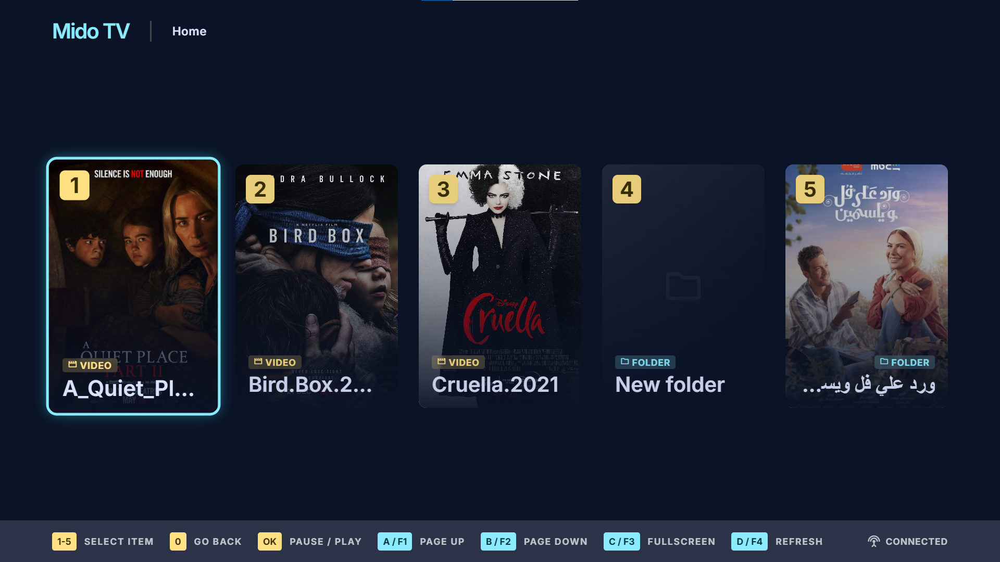
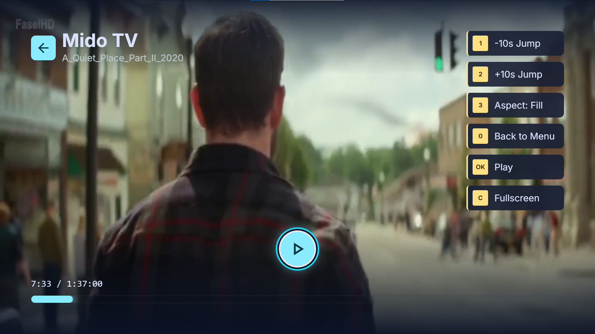

# Mido TV 📺

**Mido TV** is a sleek, modern Smart TV media center application designed for a 10-foot TV experience. Built with **React**, **Vite**, and **Tailwind CSS**, it brings a cinema-grade user interface for navigating and playing your local video collection directly from your computer or home media drive.

---

## 📸 Interface Preview





---

## ✨ Features

- **TV & Remote-Control Friendly**: Optimized for DPAD / Arrow keys, OK key, Backspace, and Number key (0-9) navigation.
- **Local Media Scanning**: Automatically scans media folders on local disk and generates video playlists and dynamic poster thumbnails.
- **Smart Single-Video Folder Detection**: Automatically detects folders containing single videos and turns them directly into instant-play titles.
- **HTML5 Video Player with HUD OSD**: Seamless playback control, time seek jumps (±10s, ±30s), aspect ratio toggling (16:9, 4:3, Fill, Fit), and auto-hiding OSD HUD.
- **Byte-Range Video Streaming**: Node/Vite backend middleware supporting range-header streaming for fast seeking in large video files (`.mp4`, `.mkv`, `.avi`, `.mov`, `.webm`, etc.).
- **Automatic Fallback Demo Mode**: Demonstrates full navigation and video player features using sample media even if local folders aren't found.

---

## 🛠️ Prerequisites

Make sure you have installed:
- [Node.js](https://nodejs.org/) (Version 18+ recommended)
- `npm` (comes with Node.js) or `yarn` / `pnpm`

---

## 🚀 Getting Started

### 1. Installation

Clone the repository and install the dependencies:

```bash
npm install
```

### 2. Run Development Server

Start the Vite development server:

```bash
npm run dev
```

Open your browser and navigate to: `http://localhost:3000`

### 3. Build for Production

To create an optimized production build:

```bash
npm run build
```

To preview the built application locally:

```bash
npm run preview
```

---

## ⚙️ How to Change the Home Directory Folder

By default, Mido TV scans `D:\Film` as its home root directory. If your media is stored in another location (e.g., `E:\Movies` or `C:\Users\YourName\Videos`), update the default root path in these files:

### 1. Update `vite.config.js`
Open [vite.config.js](file:///d:/code/Mido%20TV/vite.config.js) and update `DEFAULT_ROOT`:
```javascript
// Line 7 in vite.config.js
const DEFAULT_ROOT = 'E:\\Movies'; // Set your media directory path
```

### 2. Update `src/App.jsx`
Open [App.jsx](file:///d:/code/Mido%20TV/src/App.jsx) and update `ROOT_PATH`:
```javascript
// Line 10 in src/App.jsx
const ROOT_PATH = 'E:\\Movies'; // Set your media directory path
```

### 3. Update `src/services/fileScanner.js` (Optional Fallback)
Open [fileScanner.js](file:///d:/code/Mido%20TV/src/services/fileScanner.js) and update the default parameter:
```javascript
// Line 4 in src/services/fileScanner.js
export async function fetchDirectory(path = 'E:\\Movies') { ... }
```

---

## 🎮 Navigation & Keyboard Controls

| Key | Action |
| --- | --- |
| **Arrow Left / Right** | Navigate focus between cards |
| **Arrow Up / Down** / **PageUp / PageDown** | Switch pages |
| **Enter / OK** | Open selected folder / Play selected video / Pause video |
| **0** or **Backspace** | Go Back / Up one folder level / Exit player |
| **1 - 5** | Direct selection for slots 1-5 on active page |
| **1 / 2 (In Player)** | Seek -10s / +10s |
| **3 (In Player)** | Cycle Aspect Ratio (16:9, 4:3, Fill, Fit) |
| **F** | Toggle Fullscreen Mode |
| **D** | Refresh directory contents |

---

## 📁 Supported Media & Covers

- **Video Formats**: `.mp4`, `.mkv`, `.avi`, `.mov`, `.webm`, `.m4v`, `.ts`, `.flv`, `.wmv`
- **Folder Covers**: Automatically uses `cover.jpg`, `poster.jpg`, `folder.png`, `cover.png`, `poster.png` or any image inside the directory as folder art.
